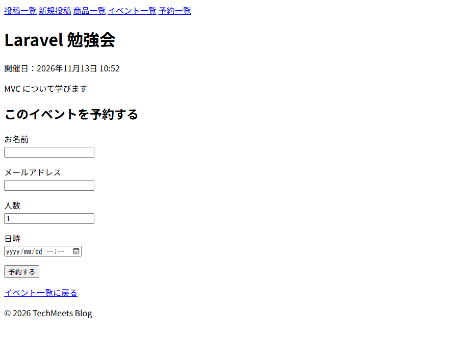
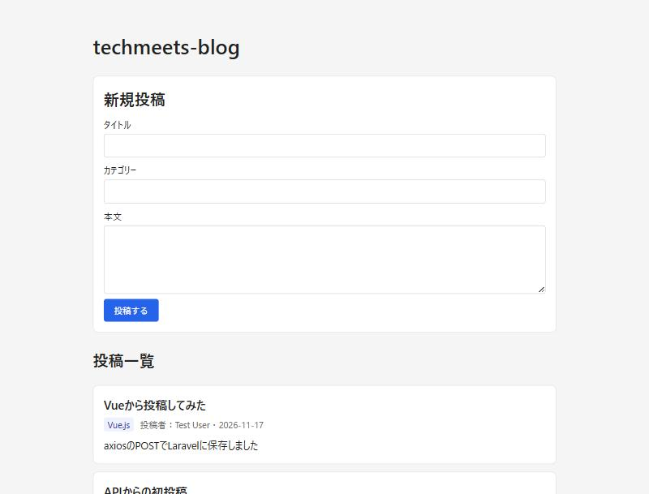

# techmeets-blog

Docker で動く Laravel 開発環境です。

## セットアップ手順

1. Docker Desktop を起動する
2. `.env.example` をコピーして `.env` を作る
3. コンテナを起動する
   ```bash
   docker compose up -d --build
   ```
4. Laravel のライブラリを入れる
   ```bash
   docker compose exec app composer install
   ```
   ※ `vendor` は表示を速くするため Docker の中（`vendor-data` ボリューム）に置いています。そのため、`src/vendor` がすでにあっても、この手順は必ずコンテナの中で実行してください。
5. `src/.env.example` をコピーして `src/.env` を作り、DB 設定を書く
   ```
   DB_CONNECTION=mysql
   DB_HOST=db
   DB_PORT=3306
   DB_DATABASE=laravel
   DB_USERNAME=root
   DB_PASSWORD=secret
   ```
6. アプリキーを作ってマイグレーションする
   ```bash
   docker compose exec app php artisan key:generate
   docker compose exec app php artisan migrate
   ```
7. 画面のデザイン（CSS）を準備する（自分の PC で実行。Node.js が必要）
   ```bash
   cd src
   npm install
   npm run build
   cd ..
   ```
8. ブラウザで確認する
   - Laravel: http://localhost
   - phpMyAdmin: http://localhost:8080
   
## 機能一覧（Week 7）

### ブログ（/posts）
- 投稿の一覧表示（10件ごとのページネーション）
- 投稿の詳細表示
- 投稿の作成・編集・削除
- 入力チェック（タイトル・内容・カテゴリーは必須）

### 商品管理（/products）
- 商品の一覧・詳細・登録・編集・削除
- 価格・在庫数は0以上の整数のみ受け付ける

### イベント予約（/events, /reservations）
- イベントの一覧・詳細表示
- イベント詳細ページから予約（名前・メール・人数・日時）
- 予約の一覧表示とキャンセル
- ※イベントの登録画面はなし（phpMyAdmin で追加）

## テーブル定義

### posts
| カラム | 型 | 説明 |
|---|---|---|
| id | bigint | 主キー |
| title | varchar(200) | タイトル |
| content | text | 本文 |
| category | varchar(50) | カテゴリー |
| created_at / updated_at | timestamp | 作成・更新日時 |

### products
| カラム | 型 | 説明 |
|---|---|---|
| id | bigint | 主キー |
| name | varchar(100) | 商品名 |
| price | int | 価格 |
| description | text | 説明 |
| stock | int | 在庫数 |
| category | varchar(50) | カテゴリー |
| created_at / updated_at | timestamp | 作成・更新日時 |

### events
| カラム | 型 | 説明 |
|---|---|---|
| id | bigint | 主キー |
| title | varchar(100) | イベント名 |
| description | text | 説明 |
| event_date | datetime | 開催日時 |
| created_at / updated_at | timestamp | 作成・更新日時 |

### reservations
| カラム | 型 | 説明 |
|---|---|---|
| id | bigint | 主キー |
| event_id | bigint | events.id への外部キー（イベント削除時に予約も削除） |
| name | varchar(50) | 予約者名 |
| email | varchar(255) | メールアドレス |
| people | int | 人数 |
| reserved_at | datetime | 予約日時 |
| created_at / updated_at | timestamp | 作成・更新日時 |

## スクリーンショット

### 投稿一覧


### 商品一覧


### イベント詳細・予約フォーム


### 予約一覧


## 機能一覧（Week 8）

### 会員機能（Laravel Breeze）
- 会員登録（/register）・ログイン（/login）・ログアウト
- プロフィール編集（/profile）

### 会員制ブログ
- 投稿の一覧・詳細は誰でも見られる
- 投稿の作成はログインした人だけ
- 投稿の編集・削除は、投稿した本人だけ（他人は 403）
- 一覧・詳細に投稿者名を表示

### コメント欄（投稿詳細ページ）
- コメントは誰でも見られる
- コメントの書き込みはログインした人だけ
- コメントの削除は、書いた本人だけ

## テーブル定義（Week 8 で追加・変更）

### posts（追加した列）
| カラム | 型 | 説明 |
|---|---|---|
| user_id | bigint | users.id への外部キー（投稿者） |

### comments
| カラム | 型 | 説明 |
|---|---|---|
| id | bigint | 主キー |
| post_id | bigint | posts.id への外部キー（投稿削除時にコメントも削除） |
| user_id | bigint | users.id への外部キー（書いた人） |
| body | text | コメント本文 |
| created_at / updated_at | timestamp | 作成・更新日時 |
## 機能一覧（Week 9）

### タスク管理（/tasks）
- ログインした人だけ使える
- 自分のタスクだけが表示される（未完了→期限が近い順）
- タスクの追加・編集・削除、完了／未完了の切り替え
- 編集・削除・切り替えは本人だけ（TaskPolicy で判定、他人は 403）

### リファクタリング（Repository / Service パターン）
コントローラーの仕事を、役割ごとのクラスに分けました。

| クラス | 役割 |
|---|---|
| Controller | リクエストを受け取って、担当に渡し、画面を返す |
| FormRequest（ProductRequest） | 入力チェック |
| Policy（PostPolicy, TaskPolicy） | 本人かどうかの判定 |
| Service（PostService, TaskService, ProductService） | 業務の手順（トランザクション、ログ） |
| Repository（PostRepository, TaskRepository, ProductRepository） | DB の読み書き |

## テーブル定義（Week 9 で追加）

### tasks
| カラム | 型 | 説明 |
|---|---|---|
| id | bigint | 主キー |
| user_id | bigint | users.id への外部キー（ユーザー削除時にタスクも削除） |
| title | varchar(100) | タイトル |
| description | text（空でもOK） | 説明 |
| due_date | date（空でもOK） | 期限 |
| is_done | boolean | 完了したか（初期値 false） |
| created_at / updated_at | timestamp | 作成・更新日時 |
## テストの実行

```bash
docker compose exec app php artisan test
```

セキュリティテストだけを実行する場合：

```bash
docker compose exec app php artisan test --filter=SecurityTest
```
## 機能一覧（Week 10）

Laravel を API として公開し、Vue.js（`my-frontend/`）から呼び出す「フロント・バック分離構成」にしました。

```
techmeets-blog/
├── docker-compose.yml
├── docker/
├── src/           # Laravel（API を提供する側）
└── my-frontend/   # Vue.js（Vite + Vue 3）。API を呼ぶ側
```

### 投稿 API（認証なし）
| メソッド | URL | 内容 |
|---|---|---|
| GET | /api/posts | 投稿一覧（新しい順、10件ずつ） |
| GET | /api/posts/{id} | 投稿1件（なければ 404） |
| POST | /api/posts | 新規投稿（title・content・category は必須。未入力は 422） |

- レスポンスの形は `PostResource` で決めている（投稿者は名前だけ返し、メールアドレスなどは返さない）
- API から作った投稿は、Seeder で作るテスト用ユーザー（test@example.com）の投稿として保存する
- `config/cors.php` で `http://localhost:5173` からのアクセスだけを許可している

## 動かし方（Week 10）

### 1. Laravel（API）を起動する
```bash
docker compose up -d
docker compose exec app php artisan migrate
docker compose exec app php artisan db:seed   # テスト用ユーザー（test@example.com）を作る
```
ブラウザで http://localhost/api/posts を開いて JSON が表示されれば OK。

### 2. フロントエンド（Vue.js）を起動する（自分の PC で実行。Node.js 18 以上が必要）
```bash
cd my-frontend
npm install
npm run dev
```
ブラウザで http://localhost:5173 を開くと、投稿フォームと投稿一覧が表示されます。

※ Laravel を 80 番以外のポートで動かしている場合は、`my-frontend/.env` に `VITE_API_URL=http://localhost:ポート番号/api` と書いてください。

### 画面


## コンポーネント分割の理由

画面を「App（組み立て役）」「PostForm（新規投稿フォーム）」「PostList（一覧の取得と表示）」「PostCard（投稿1件分の表示）」の4つに分けました。分ける基準は「そのコンポーネントが持つ仕事（とデータ）が1つになるか」です。PostForm は入力値と送信だけ、PostList は API からの一覧取得と読み込み中・エラー表示だけを担当し、それぞれ自分の state を持ちます。PostCard は state を持たず、props で受け取った1件を表示するだけなので、一覧の中で何度も繰り返し使え、将来の詳細ページなど別の画面でも使い回せます。フォームと一覧はお互いを知らず、「投稿できた」という通知（emit）を App が受け取って一覧に再取得を頼む形にしたので、片方を直しても、もう片方に影響が出にくくなっています。

## テスト（Week 10 で追加）
`tests/Feature/ApiPostTest.php`：一覧の取得、404、投稿の保存、未入力時の 422、CORS ヘッダーを確認しています。
```bash
docker compose exec app php artisan test --filter=ApiPostTest
```

## 本番環境（Week 11：AWS）

公開 URL：http://16.179.249.198 （Laravel の画面のみ公開。Week 10 の Vue.js は公開していない）

```
[ブラウザ] ──HTTP(80)──▶ [EC2: Ubuntu + Docker]
                           ├─ nginx コンテナ
                           └─ app コンテナ（PHP / Laravel）
                                 ├──3306(TLS)──▶ [RDS: MySQL 8.4]
                                 └──HTTPS──────▶ [S3: 画像]
[自分の PC] ───SSH(22)───▶ [EC2]
```

| サービス | 設定 | 理由 |
|---|---|---|
| リージョン | アジアパシフィック（シドニー）ap-southeast-2 | 無料プランのアカウントがシドニーに固定されていて、東京はプランのアップグレードが必要だったため |
| EC2 | Ubuntu Server 26.04 LTS / t3.micro | 無料利用枠の対象 |
| Elastic IP | 16.179.249.198 | 停止・開始しても IP が変わらないようにする（Week 13 のドメイン設定で使う） |
| RDS | MySQL 8.4 / db.t4g.micro / パブリックアクセスなし | DB のバックアップや更新を AWS に任せる。8.0 は延長サポート料金がかかるため 8.4 |
| S3 | `techmeets-blog-images-1103`（パブリックアクセスはブロック） | 投稿の画像を保存する |

## セキュリティグループの設計（Week 11）

「必要なポートを、必要な相手にだけ開ける」（最小権限）を基準にしました。

### EC2 用（launch-wizard-1）
| タイプ | ポート | ソース | 理由 |
|---|---|---|---|
| SSH | 22 | 自分の IP/32 | サーバーを操作できるのは自分だけでよい。0.0.0.0/0 にすると、世界中からパスワードや鍵の総当たり攻撃を受ける |
| HTTP | 80 | 0.0.0.0/0 | ブログは誰でも見られる必要がある |
| HTTPS | 443 | 0.0.0.0/0 | Week 13 で HTTPS にするときに使う。誰でも見られる必要がある点は HTTP と同じ |

- 3306（MySQL）は EC2 では開けていない。DB は RDS にあり、EC2 の中で MySQL を動かしていないため
- 自分の IP は、つなぐ回線が変わると変わる。SSH が `Connection timed out` になったら、SSH のソースを「マイIP」で選び直す
- 「マイIP」で IPv6 アドレスが入ると、IPv4 で接続している SSH は通らない。そのときはルールを削除して、IPv4（`curl https://checkip.amazonaws.com` で確認）で作り直す

### RDS 用（RDS 作成時に「EC2 コンピューティングリソースに接続」で自動作成）
| タイプ | ポート | ソース | 理由 |
|---|---|---|---|
| MySQL/Aurora | 3306 | EC2 のセキュリティグループ | DB に話しかけるのは Laravel（EC2）だけ。IP アドレスではなくセキュリティグループで指定しているので、EC2 の IP が変わっても設定を変えなくてよい |

- RDS は「パブリックアクセス：なし」なので、インターネットからは DB に一切つながらない
- アウトバウンドはデフォルト（全許可）のまま。EC2 から RDS・S3・GitHub・Docker Hub などに出ていく通信が必要なため

## デプロイ手順（Week 11）

EC2 に SSH でログインして作業します。

```bash
ssh -i ~/.ssh/techmeets-key.pem ubuntu@16.179.249.198
```

### 1. Docker のインストール
Docker 公式の apt リポジトリから `docker-ce` と `docker-compose-plugin` を入れ、`sudo usermod -aG docker ubuntu` のあと再ログインする。

### 2. clone と本番用の設定
```bash
git clone https://github.com/kantacode/techmeets-blog.git
cd techmeets-blog
echo "APP_PORT=80" > .env            # Docker Compose 用（nginx を 80 番で公開）
cp src/.env.example src/.env         # Laravel 用
```

EC2 上の `docker-compose.yml` だけ、次を本番向けに変える（DB は RDS を使うため。リポジトリの docker-compose.yml は開発用のまま）。
- `db` と `phpmyadmin` のサービスを削除
- `app` の `depends_on: - db` を削除
- `volumes:` の `db-data:` を削除

`src/.env` で変える項目：

| 項目 | 値 |
|---|---|
| APP_ENV / APP_DEBUG | `production` / `false`（true のままだとエラーの中身が誰にでも見える） |
| APP_URL | `http://16.179.249.198` |
| DB_CONNECTION | `mysql`（行頭の `#` を外す） |
| DB_HOST | RDS のエンドポイント |
| DB_DATABASE / DB_USERNAME / DB_PASSWORD | `laravel` / `admin` / RDS のパスワード |
| MYSQL_ATTR_SSL_CA | `/var/www/html/storage/certs/global-bundle.pem`（RDS と TLS で通信するための証明書） |
| AWS_ACCESS_KEY_ID / AWS_SECRET_ACCESS_KEY | S3 用 IAM ユーザーのアクセスキー |
| AWS_DEFAULT_REGION / AWS_BUCKET | `ap-southeast-2` / `techmeets-blog-images-1103` |

RDS の証明書を置く：
```bash
mkdir -p src/storage/certs
curl -o src/storage/certs/global-bundle.pem https://truststore.pki.rds.amazonaws.com/global/global-bundle.pem
```

### 3. 起動
```bash
docker compose up -d --build
docker compose exec app composer install
docker compose exec app chown -R www-data:www-data storage bootstrap/cache
docker compose exec app chmod -R 775 storage bootstrap/cache
docker run --rm -v "$(pwd)/src:/app" -w /app node:lts-slim sh -c "npm ci && npm run build"
docker compose exec app php artisan key:generate --force
docker compose exec app php artisan migrate --force
```

- `npm run build` を忘れると「Vite manifest not found」になる（`public/build/` は Git に含まれない）
- EC2 のディスクは 8GB しかないので、Node は軽い `node:lts-slim` を使い、使い終わったイメージは `docker image prune -a` で消す
- RDS 作成時に「最初のデータベース名」を空にしてしまったので、`CREATE DATABASE laravel CHARACTER SET utf8mb4 COLLATE utf8mb4_unicode_ci;` で作った

### 使わない期間
- EC2：「インスタンスを停止」（「終了」は削除なので押さない）。開始したら `docker compose up -d` でコンテナを起動し直す
- RDS：「一時的に停止」。7日たつと自動で起動するので、また止める

## 投稿に画像を付ける（Week 11：S3）

- 投稿の作成・編集フォームで画像を選べる（任意。jpg/png/gif/webp など、5MB まで）
- 画像は S3 の `images/` に保存し、DB（posts.image_path）には保存先のパスだけを入れる
- 編集で画像を差し替えたら古い画像を、投稿を削除したら画像を S3 から消す（`PostService`）

### バケットを公開しない理由
バケットは「パブリックアクセスをブロック」のままにしています。画像を表示するときは、Laravel が画像ごとに **30分だけ有効な URL**（`Storage::disk('s3')->temporaryUrl()`）を発行します。バケットを公開すると、URL を知っている人なら誰でも、いつまでも画像を見られます。この方法なら、ブログのページから見たときだけ表示できます。

### IAM ユーザーは最小権限
Laravel 用の IAM ユーザー `techmeets-blog-s3` には、このバケットだけを操作できるポリシーを付けました（`AmazonS3FullAccess` は全部のバケットを操作できてしまうので使わない）。アクセスキーは EC2 の `src/.env` にだけ書き、GitHub には上げていません。

```json
{
  "Version": "2012-10-17",
  "Statement": [
    { "Effect": "Allow", "Action": ["s3:ListBucket"], "Resource": "arn:aws:s3:::techmeets-blog-images-1103" },
    { "Effect": "Allow", "Action": ["s3:GetObject", "s3:PutObject", "s3:DeleteObject"], "Resource": "arn:aws:s3:::techmeets-blog-images-1103/*" }
  ]
}
```

## テーブル定義（Week 11 で追加）

### posts（追加した列）
| カラム | 型 | 説明 |
|---|---|---|
| image_path | varchar(255)（空でもOK） | S3 に保存した画像のパス（例：images/xxxx.jpg） |
