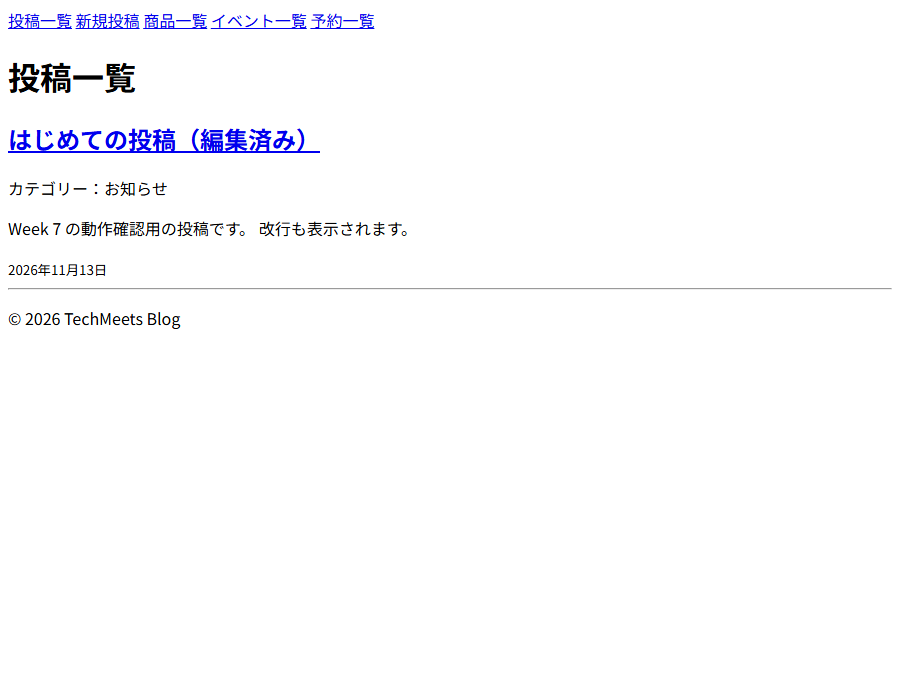
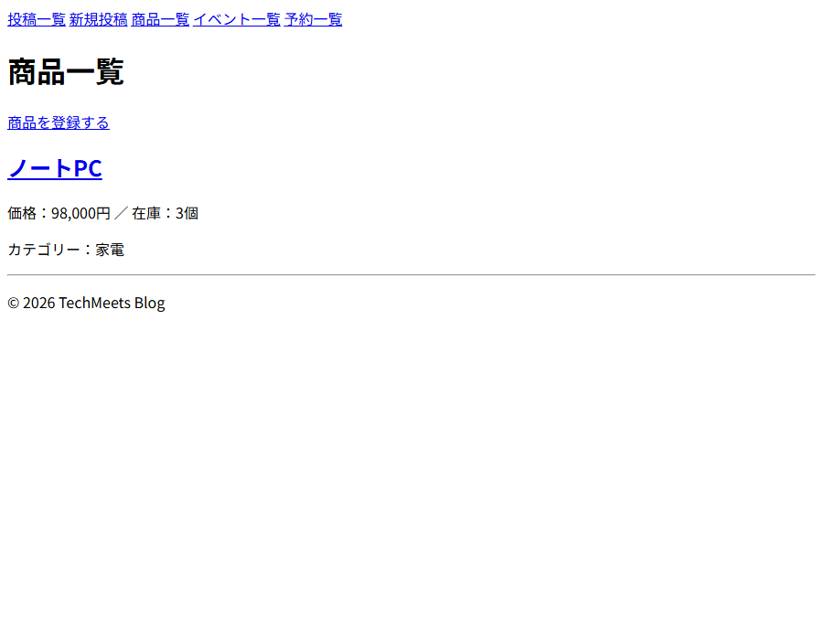
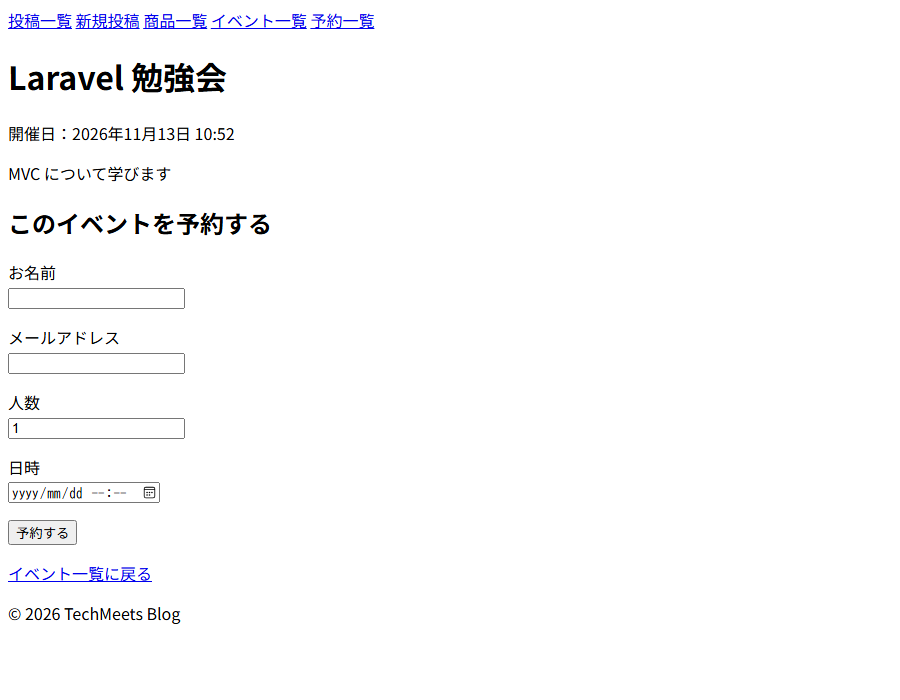
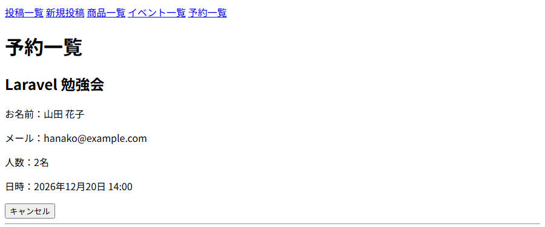

# techmeets-blog

Docker で動く Laravel 開発環境です。

## セットアップ手順

1. Docker Desktop を起動する
2. `.env.example` をコピーして `.env` を作る
3. コンテナを起動する
   ```bash
   docker compose up -d --build
   ```
4. Laravel のライブラリを入れる
   ```bash
   docker compose exec app composer install
   ```
5. `src/.env.example` をコピーして `src/.env` を作り、DB 設定を書く
   ```
   DB_CONNECTION=mysql
   DB_HOST=db
   DB_PORT=3306
   DB_DATABASE=laravel
   DB_USERNAME=root
   DB_PASSWORD=secret
   ```
6. アプリキーを作ってマイグレーションする
   ```bash
   docker compose exec app php artisan key:generate
   docker compose exec app php artisan migrate
   ```
7. ブラウザで確認する
   - Laravel: http://localhost
   - phpMyAdmin: http://localhost:8080
   
## 機能一覧（Week 7）

### ブログ（/posts）
- 投稿の一覧表示（10件ごとのページネーション）
- 投稿の詳細表示
- 投稿の作成・編集・削除
- 入力チェック（タイトル・内容・カテゴリーは必須）

### 商品管理（/products）
- 商品の一覧・詳細・登録・編集・削除
- 価格・在庫数は0以上の整数のみ受け付ける

### イベント予約（/events, /reservations）
- イベントの一覧・詳細表示
- イベント詳細ページから予約（名前・メール・人数・日時）
- 予約の一覧表示とキャンセル
- ※イベントの登録画面はなし（phpMyAdmin で追加）

## テーブル定義

### posts
| カラム | 型 | 説明 |
|---|---|---|
| id | bigint | 主キー |
| title | varchar(200) | タイトル |
| content | text | 本文 |
| category | varchar(50) | カテゴリー |
| created_at / updated_at | timestamp | 作成・更新日時 |

### products
| カラム | 型 | 説明 |
|---|---|---|
| id | bigint | 主キー |
| name | varchar(100) | 商品名 |
| price | int | 価格 |
| description | text | 説明 |
| stock | int | 在庫数 |
| category | varchar(50) | カテゴリー |
| created_at / updated_at | timestamp | 作成・更新日時 |

### events
| カラム | 型 | 説明 |
|---|---|---|
| id | bigint | 主キー |
| title | varchar(100) | イベント名 |
| description | text | 説明 |
| event_date | datetime | 開催日時 |
| created_at / updated_at | timestamp | 作成・更新日時 |

### reservations
| カラム | 型 | 説明 |
|---|---|---|
| id | bigint | 主キー |
| event_id | bigint | events.id への外部キー（イベント削除時に予約も削除） |
| name | varchar(50) | 予約者名 |
| email | varchar(255) | メールアドレス |
| people | int | 人数 |
| reserved_at | datetime | 予約日時 |
| created_at / updated_at | timestamp | 作成・更新日時 |

## スクリーンショット

### 投稿一覧


### 商品一覧


### イベント詳細・予約フォーム


### 予約一覧
